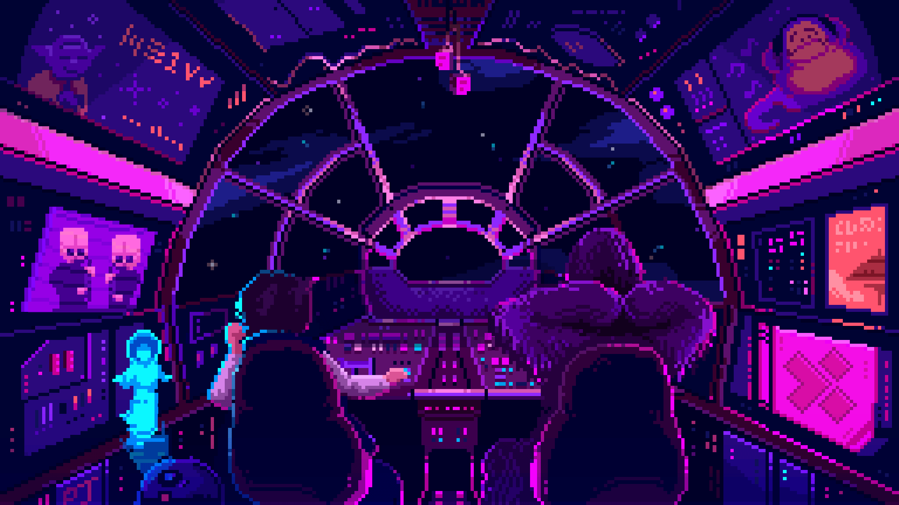

# Hi, I'm Nicolas Fromont.



<div align="center">
  <a href="mailto:nifromon@student.42Perpignan.fr">
    
  </a>
  <a href="https://linkedin.com/in/nifromon">
    
  </a>
</div>

## 👨🏻‍💻 About me :
```yaml
name: Nicolas Fromont
located_in: Perpignan, France
current_job: Computer Sciences Student

education:
  agora_high_school:
    [
      "Life and Earth Sciences",
      "Engineer Sciences",
      "Mathematics"
    ]
  forty_two: Computer Sciences

fields_of_interests:
  [
    "Graphics and Games",
    "System and Kernels",
    "Cybersecurity"
  ]

currently_learning:
  [
    "",
  ]
```

## 🏗️ Projects :

### Rank_00
---
[](https://github.com/nifromon66/libft)
---

### Rank_01
---
[](https://github.com/nifromon66/Ft_printf)
[](https://github.com/nifromon66/Get_next_line)
[](https://github.com/nifromon66/Born2beroot)
---

### Rank_02
---
[](https://github.com/nifromon66/Push_swap)
[](https://github.com/nifromon66/Minitalk)
[](https://github.com/nifromon66/So_long)
---

### Rank_03
---

[](https://github.com/nifromon66/Minishell)
---

[](https://github.com/nifromon66/Inception)

## 🛠️ Languages and Tools :

<p align="center">
  
  
  
</p>

## ⚡ Stats :

[](https://github-stats-extended.vercel.app/api?username=nifromon66&custom_title=My%20GitHub%20Stats&show=reviews%2Cdiscussions_started%2Cdiscussions_answered%2Cprs_merged%2Cprs_merged_percentage%2Cprs_commented%2Cprs_reviewed%2Cissues_commented%2Ccontributions%2Call_time_contribs&show_icons=true&include_all_commits=true&theme=nightowl)
[](https://github-stats-extended.vercel.app/api/top-langs?username=nifromon66&langs_count=9&theme=nightowl)

## 🐍 My contributions :

<div align="center">
  <picture>
    <source media="(prefers-color-scheme: dark)" srcset="https://raw.githubusercontent.com/nifromon66/nifromon66/output/github-contribution-grid-snake-dark.svg" />
    <source media="(prefers-color-scheme: light)" srcset="https://raw.githubusercontent.com/nifromon66/nifromon66/output/github-contribution-grid-snake.svg" />
    
  </picture>
</div>


